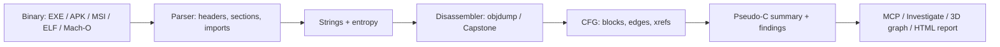

# RE Lab Advanced — Engineering-Level Tutorial

**Copyright (c) SKYTAR — www.shihabskytar.com**

**Tool:** `RE-Lab-Advanced.py` — a read-only, lab-level reverse-engineering tool.
**Audience:** Cybersecurity students, engineers, and specialists who analyse software they own or have written permission to test.
**Rule first:** Never use this tool to patch a binary, generate a licence key, bypass a trial, or analyse software you do not have permission to test. Work in an isolated VM, on a copy, never on the only original.

---

## 1. What the tool is, in one paragraph

A compiled program is not text. It is a file format (PE, ELF, Mach-O, APK, MSI, …) that contains headers, sections, machine code, and data. This tool reverses that process in layers: it parses the container, extracts strings, disassembles machine code into assembly, builds a control-flow graph (CFG) of blocks and jumps, summarises each function in heuristic pseudo-C, and then lets you — or a coding agent via MCP — ask questions about one feature, follow its calls, and compare two builds.

It is **not** Ghidra, IDA, or a full decompiler. It is a fast, scriptable first pass that tells you where to look next, and what to verify in source code or in Ghidra.



## 2. Architecture

| Layer | File / function in the script | What it actually does |
|---|---|---|
| File loaders | `parse_pe`, `parse_elf`, `parse_macho`, `parse_zip_container`, `parse_cfb_msi`, `parse_cab`, `_parse_dex`, `detect_and_parse` | Reads magic bytes, then headers with `struct`. PE: DOS → PE → COFF → Optional header → sections → import directory. ELF: ELF header → section headers → section names. ZIP: `zipfile` entries, DEX header counts, native `.so` list. CFB/MSI: sector size, FAT chain, 128-byte directory entries. |
| Strings | `extract_strings` | ASCII and UTF-16LE runs of 4+ printable characters. A string is a lead, not proof. |
| Disassembler | `disassemble` | Tries Capstone if installed, otherwise system `objdump -d -M intel --no-show-raw-insn`. Never executes the target. Limit: 10,000 instructions by default, to keep reports usable. |
| CFG builder | `build_cfg`, `_branch_targets` | Leaders are function starts, jump/call targets, and fall-throughs after branches. Blocks are split at leaders. Edges are `jump`, `call`, and `fallthrough`. Xrefs map a target address → list of callers/jumpers. **Bug that was fixed:** objdump prints `je 4016 <label>`, not `je 0x4016`. The old code only looked for `0x…`, so most jump edges were missing. `_branch_targets` now handles both forms. |
| Decompiler-lite | `summarize_functions`, `pseudo_c_for_function` | Per function: instruction count, calls, branch count, backward jumps (possible loops), `cmp`/`test` count. Pseudo-C translates `mov` → assignment, `cmp` → `if (…)`, `call` → `call …`, `ret` → `return`. It does **not** recover variables, types, or original source. |
| Findings | `build_findings`, `risk_score` | PE hardening flags (ASLR, DEP/NX, Control Flow Guard, High-Entropy VA), unsafe imports (`strcpy`, `sprintf`, `gets` — normalised so `strcpy@plt` and `_strcpy` also match), weak crypto (`MD5_Init`, `SHA1`, `DES`, `RC4`), possible hard-coded secrets (regex, first hit only — verify, it can be a false positive). Score: High = 10, Medium = 4, Low = 1. |
| Agent bridge | `run_mcp_server`, `MCP_TOOLS` | JSON-RPC over stdio. Tools: `analyze_binary`, `list_functions`, `get_function`, `search_strings`, `get_xrefs`, `get_call_graph`, `investigate`, `list_sections`, `list_imports`, `export_call_graph_3d`. |
| Investigation | `investigate`, `call_graph`, `call_graph_3d_html`, `html_report`, `compare_binaries` | One question → matched strings + functions + 1-hop call neighbours + pseudo-C. Call graph as JSON, DOT, or interactive 3D HTML. Compare mode diffs sections, imports, and strings between two builds — ideal for before/after a fix. |

## 3. Lab setup

### Linux (recommended for ELF / objdump work)

```bash
python3 --version          # 3.10+
which objdump readelf      # objdump is used for disassembly
python3 RE-Lab-Advanced.py /bin/ls --no-disasm
```

### Windows

```powershell
# Install Python 3.12+ from python.org, tick "Add Python to PATH", restart the terminal
python --version
cd C:\Tools\RE-Lab
python RE-Lab-Advanced.py "C:\path\to\app.exe"
```

For full disassembly on Windows, install LLVM or MinGW and confirm `objdump --version` works. Without it, the tool still reports headers, sections, imports, strings, and findings, and says disassembly is unavailable.

**Do not double-click the `.py` file.** Use the terminal, or the supplied `Run-RE-Lab-Windows.cmd` launcher, which pauses so you can read errors. The `trace` mode needs Linux `strace` and is refused without `--allow-run` — it does not apply on Windows.

### Safety checklist

1. Copy the target to a lab folder. Never analyse the only copy.
2. Use a VM or isolated machine for unknown binaries.
3. Do not upload a proprietary binary to a public LLM. The `--json` / `--explain` outputs are text-only summaries for that reason.
4. Record hash, version, and source before you start, so a finding can be reproduced.

## 4. Core commands

```bash
# Basic report: headers, sections, strings, findings
python3 RE-Lab-Advanced.py app.exe

# With machine-readable outputs
python3 RE-Lab-Advanced.py app.exe --json report.json --explain explain.md

# One feature, REA-style: "what does this do?"
python3 RE-Lab-Advanced.py investigate app.exe "free"
python3 RE-Lab-Advanced.py investigate app.apk "login"

# Call graph
python3 RE-Lab-Advanced.py graph app.exe --format dot > graph.dot
python3 RE-Lab-Advanced.py graph app.exe --format json
python3 RE-Lab-Advanced.py graph app.exe --format html3d --out callgraph-3d.html

# Full HTML report (also writes callgraph-3d.html next to it)
python3 RE-Lab-Advanced.py html app.exe --out re-report.html

# Compare two builds: before vs after a fix
python3 RE-Lab-Advanced.py compare app-old.exe app-new.exe --json diff.json

# Interactive REPL
python3 RE-Lab-Advanced.py repl
#   load "C:\path\to\app.exe"
#   functions
#   function malloc
#   strings free
#   xrefs 0x4016
#   graph dot
#   investigate login
#   findings
#   quit

# MCP server for a coding agent (stdio, waits for JSON-RPC)
python3 RE-Lab-Advanced.py mcp
```

On Windows, replace `python3` with `python` and quote paths with spaces.

## 5. The 3D tutorial — reading a call graph in three dimensions

Generate it first:

```bash
python3 RE-Lab-Advanced.py graph app.exe --format html3d --out callgraph-3d.html
# or
python3 RE-Lab-Advanced.py html app.exe --out re-report.html
# then open callgraph-3d.html in a browser
```

The HTML file is standalone except for Three.js loaded from a CDN. It needs no server and sends no data anywhere.

### Controls

- **Drag** — rotate the whole graph. This is the key 3D advantage: a flat DOT graph hides edges behind nodes; rotating reveals them.
- **Scroll** — zoom in on a cluster, or out to see the whole program.
- **Colour** — the first node is amber, the rest are blue. Colour is not severity; use the findings table for severity.

### How to read it, step by step

1. **Start zoomed out.** You should see one large, dense cluster (the main program logic) and a halo of small stubs around it (PLT / import stubs such as `free@plt`, `malloc@plt`). That halo is normal.
2. **Find a hub.** A node with many incoming edges is a shared helper — logging, memory allocation, error handling, string formatting. Click-zoom is not implemented; instead, rotate until that hub is in front, then look up its name in `investigate` or `get_function`.
3. **Follow one feature.** Pick a function from `investigate <query>`, note its 1-hop neighbours in the report, then find those names in the 3D graph. A chain that goes `feature → helper → helper → import` is a call chain you can now read in pseudo-C, one function at a time.
4. **Look for outliers.** A lone node far from the main cluster, or a node that calls many imports but is called by almost nothing, is worth investigating — it may be dead code, an optional feature, or a backdoor-like path. It is **not** proof of malice; verify in source.
5. **Compare before and after a fix.** Generate a 3D graph for the old build and the new build, and run `compare`. If a risky import disappears from the diff, and the graph loses that edge, the fix actually took effect in the binary — not just in source.

### 3D limits

- The graph is capped at 80 nodes and 300 edges for readability. Large programs will be truncated — use `investigate` or DOT/JSON for the full graph.
- Node positions are deterministic rings, not a physics simulation. Distance is **not** a measure of similarity or trust.
- Stripped binaries merge several real functions under one label (for example, a label like `_obstack_begin@@Base-0x8ef0` covering a whole `.text` region). The tool warns on blocks over 500 instructions. For true function recovery on stripped binaries, use Ghidra.

## 6. Worked example — finding a bug, then fixing it

Suppose `build_findings` reports:

```
[high] unsafe-function: Imported msvcrt.dll!strcpy
Fix: Use strcpy_s / strncpy_s with an explicit size, or a safe string type.
```

Engineering workflow:

1. **Locate it:** `investigate app.exe "strcpy"` → which functions call it, and what strings are nearby.
2. **Read it:** `get_function` / pseudo-C for the caller → is the source length attacker-controlled? Is there a length check before the call? If yes, it may be safe in context; if no, it is a classic buffer-overflow candidate.
3. **Fix it in source:** replace `strcpy(dst, src)` with `strcpy_s(dst, sizeof(dst), src)` or a bounded copy, and check the return value.
4. **Rebuild and compare:** `compare app-old.exe app-new.exe` → `strcpy` should be gone from `imports_only_in_a`, and the risk score should drop.
5. **Re-test:** run the program's own tests, especially with long inputs, and confirm no crash and no truncation bug was introduced.

Apply the same loop to hardening findings: enable `/DYNAMICBASE`, `/NXCOMPAT`, and `/GUARD:CF` in the build, rebuild, and confirm the flags appear in the new report. For a possible hard-coded secret: move it to a vault / environment variable, rotate the exposed value, and confirm the string disappears from the new binary's strings.

## 7. Formats — what each one gives you

| Format | What the tool parses | What you still need a dedicated tool for |
|---|---|---|
| EXE / DLL / SYS (PE) | Headers, sections, imports, hardening flags, .NET CLR detection | Full decompilation: Ghidra / ILSpy / dnSpy for .NET |
| ELF / .so | Headers, sections, entry point | Symbols for stripped binaries: Ghidra |
| Mach-O | 32/64-bit headers, segments, sections | macOS disassembly: Ghidra / Hopper |
| APK / AAB | ZIP entries, DEX header counts (strings, types, methods, classes), native `.so` list | DEX decompilation: jadx / apktool; AXML decoding: apktool / androguard |
| IPA / MSIX | ZIP entries, `Payload/*.app/` and `AppxManifest.xml` detection | iOS / MSIX tooling in their own labs |
| MSI | OLE Compound File directory, streams | MSI tables: msitools / Orca; extract embedded CABs separately |
| CAB | `MSCF` file list | CAB extraction: `cabextract` / Windows `expand` |
| DEX (standalone) | Header counts only | DEX decompilation: jadx |
| Unknown / packed | Hash, strings, entropy, embedded-signature scan | Unpack first (with permission) in your lab, then re-analyse |

For APK native code: extract the `.so` from the APK and analyse that file separately with this tool. For MSI embedded files: extract the stream / CAB first, then analyse it.

## 8. MCP — letting a coding agent use the tool

Start the server:

```bash
python3 RE-Lab-Advanced.py mcp
```

Send JSON-RPC lines on stdin, for example:

```json
{"jsonrpc":"2.0","id":1,"method":"initialize","params":{}}
{"jsonrpc":"2.0","id":2,"method":"tools/list","params":{}}
{"jsonrpc":"2.0","id":3,"method":"tools/call","params":{"name":"investigate","arguments":{"path":"app.exe","query":"login"}}}
{"jsonrpc":"2.0","id":4,"method":"tools/call","params":{"name":"export_call_graph_3d","arguments":{"path":"app.exe","out":"callgraph-3d.html"}}}
```

The server is stateless and read-only: each call re-loads the file from disk. It never writes to the target, and it never uploads the binary. If your agent framework supports MCP over stdio, point it at this command; otherwise, use `--json` / `--explain` as the bridge.

## 9. Extending the tool — engineering exercises

1. **Add a new format:** write a `parse_*` function returning `{"format": …, "sections": […], "imports": […]}`, add it to `detect_and_parse`, and test it on a real file and on a truncated file (it must not crash).
2. **Add a new MCP tool:** add an entry to `MCP_TOOLS` and a branch in `_mcp_call_tool`, then test it with a `tools/call` JSON line.
3. **Add a new finding:** add a risky import or a hardening check to `build_findings`, with a fix suggestion, and a test case that proves it fires — and a test case that proves it does **not** fire on a safe equivalent.
4. **Improve pseudo-C:** track one register through `mov`/`add`/`cmp` in a single basic block and emit a real `if` condition instead of a comment. Compare your output to Ghidra's decompilation for the same function and note where yours is wrong — that gap is the lesson.
5. **3D graph exercise:** generate a 3D graph for a program you wrote yourself, with known functions. Can you identify each function from the graph alone, without labels? If not, what extra information (call counts, string references, section) would you need to add to the nodes?

## 10. Troubleshooting

| Symptom | Likely cause | Fix |
|---|---|---|
| `python: command not found` on Windows | Python not in PATH | Reinstall Python with "Add Python to PATH", restart the terminal |
| Window closes instantly | Double-clicking a `.py` file | Run from PowerShell, or use `Run-RE-Lab-Windows.cmd` |
| "Disassembly unavailable" | No `objdump` / Capstone | Install LLVM or MinGW (Windows) or `binutils` (Linux); headers/strings/findings still work |
| One huge function (500+ instructions) | Stripped binary, symbols missing | Use Ghidra for function recovery; treat the block as "multiple functions merged" |
| No functions, but strings work | ZIP/APK/MSI container, not a raw executable | Extract the inner `.so` / `.exe` / DEX and analyse that file |
| `trace` refuses | No `--allow-run`, or no `strace` | That is by design. Only use it on a trusted lab sample, in an isolated VM, on Linux |
| MCP client gets no reply | You sent a notification (no `id`) | Notifications get no response by design; send a request with an `id` |

## 11. Ethics and scope, again, because it matters

- Analyse only software you own, wrote, or have written permission to test.
- Do not use findings to bypass licensing, trials, or DRM, to generate keys, or to patch a program you do not own.
- If you find a vulnerability in someone else's software, report it through their official security channel, with a reproduction on a version you are allowed to test, and give them time to fix it before publishing.
- A finding from this tool is a hypothesis. Confirm it in source code, with a test case, before you call it a bug.

---

*Copyright (c) SKYTAR — www.shihabskytar.com*
*RE Lab Advanced is a lab tool. It does not patch targets, execute untrusted binaries by default, or bypass licences.*
